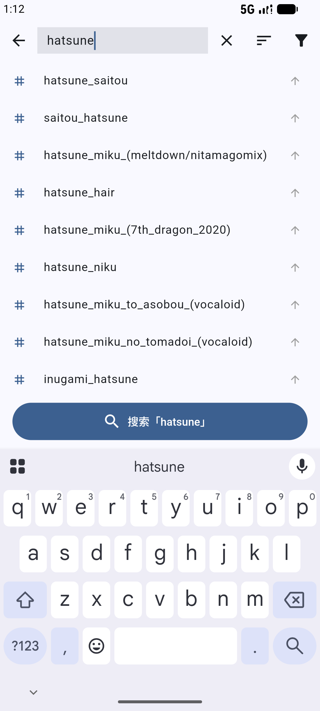

<div align="center">

<p align="center"></p>

# BooruNova

**One app, every booru.** The open-source Android client that speaks all major
booru engines (Danbooru, Gelbooru, Moebooru, e621, Sankaku, Zerochan, Rule34,
Shimmie2/paheal, and KVS video sites) — one search bar, one timeline, one place
for favorites & downloads. Images and videos, in the same app.

English / [简体中文](README_cn.md)

[](LICENSE)
[](https://github.com/qingzhuo-cn/boorunova/releases)
[](https://flutter.dev)
[](CONTRIBUTING.md)
[](https://github.com/qingzhuo-cn/boorunova/releases)
[](https://github.com/qingzhuo-cn/boorunova)

<br>

### 📲 Try it now

**Latest: [v1.8.6](https://github.com/qingzhuo-cn/boorunova/releases/latest)** — Android 8.0+

Most phones want the **arm64** build (19 MB). Use the **universal** one only if
you're on an emulator or a rare x86_64 device.

[⬇️ arm64-v8a (recommended)](https://github.com/qingzhuo-cn/boorunova/releases/latest/download/app-arm64-v8a-release.apk) &nbsp;·&nbsp;
[⬇️ universal](https://github.com/qingzhuo-cn/boorunova/releases/latest/download/app-release.apk) &nbsp;·&nbsp;
[all releases](https://github.com/qingzhuo-cn/boorunova/releases)

</div>

---

## Table of Contents

- [Screenshots](#screenshots)
- [Why BooruNova](#why-boorunova)
- [Features](#features)
- [Supported Sites](#supported-sites)
- [Download](#download)
- [Quick Start](#quick-start)
- [Usage](#usage)
- [How It Works](#how-it-works)
- [Development](#development)
- [Related Projects](#related-projects)
- [License](#license)

## Screenshots

<div align="center">
  
  &nbsp;&nbsp;
  
  <br>
  <sub><b>Left:</b> masonry timeline with per-post favorite &nbsp;·&nbsp; <b>Right:</b> debounced tag autocomplete</sub>
</div>

## Why BooruNova

Browsing multiple booru sites usually means juggling several apps or clunky mobile websites, each with different search syntax, tag layouts, and quirks. BooruNova was built to be a single, fast, native client that speaks every major booru engine — one search bar, one timeline, one place for favorites and downloads.

Everything is native Flutter, everything is on-device, and nothing is gated behind an account.

## Features

### Browsing
- 🖼️ **Multi-server support** — browse every configured site from one app
- 🔀 **One-tap site switching** — tap the site icon in the search bar to jump between servers, no page reload
- 🌊 **Masonry timeline** — adjustable grid columns (2–6, remembered across restarts), seamless infinite scroll
- 🔍 **Full-screen viewer** — pinch-zoom, swipe navigation, slideshow mode
- 👆 **Peek on long-press** — press and hold any tile for a floating preview, release to dismiss
- 🧭 **Explore** — hot / newest / random browsing without typing a query
- 🎬 **Video playback** — video posts play right in the app; mp4 and HLS (m3u8) streams both supported
- 🗃️ **Pools** — browse image sets, shown only for engines that actually implement them
- 🏷️ **Categorized tags** — artist / character / copyright / general / meta

### Search
- ✨ **Tag autocomplete** — debounced, per-server cached suggestions
- 🔥 **Trending tags** — pulled live from the current site
- ✏️ **Editable query** — tap the search bar after searching to refine the tags in place
- 🕘 **Search history** — last 20 queries, one-tap re-run
- 🎚️ **Sort & rating filters** — relevance / score / date / rating, merged into the query for you

### Favorites & Downloads
- ⭐ **Favorites** — tracked per-server, cross-app
- 💾 **Download to gallery** — sample or original quality, your choice
- 🕐 **Browse history & downloads** — tap any record to view it again, share it, or open it in another app
- 📦 **Batch operations** — favorite, download, and share multiple posts

### Personalization
- 🎨 **Themes** — light / dark / midnight with custom accent colors
- 👆 **Configurable gestures** — swipe / tap / long-press actions
- 🌍 **Bilingual UI** — full English and Chinese, switchable in settings
- 🚫 **Tag blacklist** — hide what you don't want to see
- ♿ **Reduce animations** — instant page transitions when motion bothers you
- 🌐 **Custom Hosts mapping** — reach sites from restricted networks, without breaking HTTPS

### Data Management
- 🗄️ **Full backup & restore** — servers, favorites, history, blacklist, settings
- 🧹 **Cache management** — reclaim storage in one tap
- 🙋 **First-run guide** — a short walkthrough for new installs

## Supported Sites

Any site running one of these engines can be added by URL — the app auto-detects the engine:

| Engine | Example sites |
|--------|---------------|
| Danbooru | danbooru.donmai.us |
| Gelbooru (v0.2 API) | gelbooru.com, safebooru.org, xbooru.com, realbooru.com, tbib.org, rule34.us |
| Moebooru | yande.re, konachan.com |
| e621 | e621.net |
| Sankaku | chan.sankakucomplex.com |
| Zerochan | zerochan.net |
| Rule34 | rule34.xxx |
| Shimmie2 / Paheal | rule34.paheal.net, allgirls.paheal.net |
| Video sites (KVS) | rule34video.com and other sites on the same engine |

## Download

Grab the latest APK from [GitHub Releases](https://github.com/qingzhuo-cn/boorunova/releases).

| Package | Size | For |
|---------|------|-----|
| `app-arm64-v8a-release.apk` | 19 MB | **Almost every phone** — recommended |
| `app-release.apk` | 38 MB | Emulators and rare x86_64 devices (arm64 + x86_64) |

Both are signed with the same release key, so you can switch between them freely —
Android treats them as the same app and a straight upgrade over the other.

**Requires Android 8.0 (API 26) or newer.**

> The APK is signed with a release key. Installing over a previous build is a
> straight upgrade — your servers, favorites, and history are untouched.

## Quick Start

### Prerequisites

| Requirement | Version |
|-------------|---------|
| Flutter SDK | >= 3.10.4 |
| Dart | >= 3.0.3 |
| Android SDK | API 26+ |

### Run from source

```bash
git clone https://github.com/qingzhuo-cn/boorunova.git
cd boorunova
flutter pub get
flutter run
```

### Build a release APK

```bash
flutter build apk --release --target-platform android-arm64,android-x64
```

`--target-platform` is required: without it the universal APK also packs
armeabi-v7a and grows from ~38 MB to ~56 MB, contradicting the download table above.

Outputs: `build/app/outputs/flutter-apk/app-arm64-v8a-release.apk` (arm64) and
`build/app/outputs/flutter-apk/app-release.apk` (universal).

Signing needs `android/key.properties` + `android/release.jks`. Without them the
release build **fails on purpose** instead of silently shipping a debug-signed APK —
see [docs/RELEASING.md](docs/RELEASING.md).

## Usage

### Adding a server

| Step | Action |
|------|--------|
| 1 | Open the **Servers** page, tap **+** |
| 2 | Enter the site URL (e.g. `https://safebooru.org`) |
| 3 | Tap **探测 / Detect** — the engine is auto-matched |
| 4 | Confirm the engine, name it, save |

### Switching sites

Tap the site icon on the left of the search bar. The whole server list opens as
a menu with the active one ticked — no need to leave the timeline you're on.

### Reordering servers

Tap the sort button (top-right of the Servers page) to enter drag-reorder mode, then drag to taste.

### Searching

Type a tag and pick from live suggestions, or combine with sort/rating filters from the toolbar (`order:score`, `rating:s`, …) — they're merged into the query for you. After a search, tap the search bar again to edit the tags in place instead of starting over.

## How It Works

```
┌─────────────┐    ┌──────────────────┐    ┌─────────────────┐
│  UI (Riverpod) │──▶│  BooruRegistry    │──▶│  Engine (8 impl) │
│  screens/widgets │   │  createRepository │   │  per-site repo   │
└─────────────┘    └──────────────────┘    └────────┬────────┘
                                                     │
                           ┌─────────────────────────┘
                           ▼
                    ┌──────────────┐    ┌──────────────┐
                    │  BaseBooru    │──▶│   Parser      │──▶ BooruPost
                    │  Repository   │   │ (per engine)  │
                    │  (dio+server) │    └──────────────┘
                    └──────┬───────┘
                          │
                    ┌─────▼──────┐
                    │ DioFactory │──▶ timeouts, UA, hosts connection mapping
                    └────────────┘
```

Every engine is a thin `BaseBooruRepository` subclass — it only declares its endpoints and parser. Networking is centralized in `DioFactory`, so one fix applies everywhere.

**Hosts mapping happens at the connection layer, not on the URL.** A custom
mapping resolves the target IP for the TCP connection while the request URL
keeps the original domain — so query parameters survive, and HTTPS still
negotiates with the correct SNI and certificate. Rewriting the URL instead would
silently drop query strings and break TLS on every mapped site.

## Development

| Task | Command |
|------|---------|
| Analyze | `flutter analyze` |
| Run tests | `flutter test` |
| Add an engine | subclass `BaseBooruRepository`, register in `BooruRegistry` |

The test suite is 85 cases across five layers: per-engine parsers against
real-shaped and malformed responses (`test/boorus/`), the paging state machine,
concurrent download writes, cross-server id isolation, and the hosts connection
mapping — including a real TLS handshake against a local self-signed server.

## License

[GNU AGPL-3.0](LICENSE) © BooruNova contributors

BooruNova is free software: you can redistribute it and/or modify it under the
terms of the GNU Affero General Public License as published by the Free Software
Foundation, either version 3 of the License, or (at your option) any later
version. It is distributed in the hope that it will be useful, but **without any
warranty**; without even the implied warranty of merchantability or fitness for
a particular purpose. See the [LICENSE](LICENSE) file for details.
