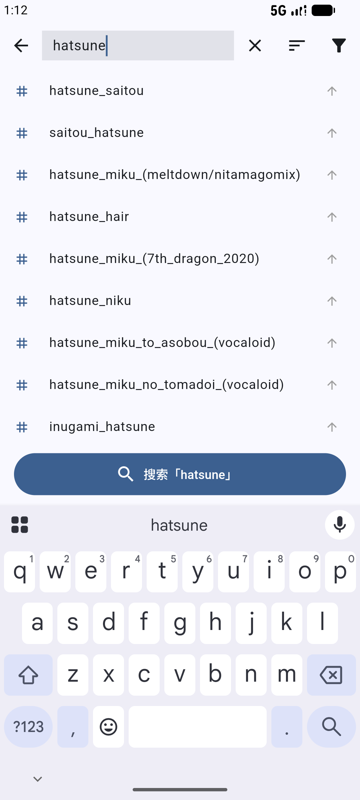

<div align="center">

<p align="center"></p>

# BooruNova [](https://awesome.re)

**一个客户端，浏览所有图站。** 开源的 Android Booru 图站聚合客户端——一个搜索栏、一条时间线、一个收藏与下载的家，10 大引擎通吃，图片与视频同看。

[English](README.md) / 简体中文

[](LICENSE)
[](https://github.com/qingzhuo-cn/boorunova/releases)
[](https://flutter.dev)
[](CONTRIBUTING.md)
[](https://github.com/qingzhuo-cn/boorunova/releases)
[](https://github.com/qingzhuo-cn/boorunova)

<br>

### 📲 立即下载

**最新版本：[v1.8.7](https://github.com/qingzhuo-cn/boorunova/releases/latest)** —— Android 8.0+

绝大多数手机装 **arm64** 那个（19 MB）就够了；**通用包**留给模拟器和少数 x86_64 设备。

[⬇️ arm64-v8a（推荐）](https://github.com/qingzhuo-cn/boorunova/releases/latest/download/app-arm64-v8a-release.apk) &nbsp;·&nbsp;
[⬇️ 通用包](https://github.com/qingzhuo-cn/boorunova/releases/latest/download/app-release.apk) &nbsp;·&nbsp;
[全部版本](https://github.com/qingzhuo-cn/boorunova/releases)

</div>

---

## 目录

- [界面截图](#界面截图)
- [为什么做 BooruNova](#为什么做-boorunova)
- [功能特性](#功能特性)
- [支持站点](#支持站点)
- [下载](#下载)
- [快速开始](#快速开始)
- [使用说明](#使用说明)
- [实现原理](#实现原理)
- [开发](#开发)
- [相关项目](#相关项目)
- [开源协议](#开源协议)

## 界面截图

<div align="center">
  
  &nbsp;&nbsp;
  
  <br>
  <sub><b>左：</b>瀑布流时间线，逐帖收藏 &nbsp;·&nbsp; <b>右：</b>防抖标签自动补全</sub>
</div>

## 为什么做 BooruNova

在多个 booru 图站之间切换，通常意味着同时装好几个应用，或者忍受难用的移动网页——每家的搜索语法、标签布局、怪癖都不一样。BooruNova 的目标是做一个统一、快速、原生的客户端，说遍所有主流 booru 引擎的「语言」：一个搜索框、一条时间线、一个收藏与下载的家。

纯原生 Flutter 实现，数据全部留在本地，不注册、不登录、不上传。

## 功能特性

### 浏览
- 🖼️ **多服务器支持** —— 一个应用浏览所有已配置站点
- 🔀 **一键切换站点** —— 点搜索栏左侧的站点图标即可在服务器之间跳转，不必离开当前时间线
- 🌊 **瀑布流时间线** —— 2–6 列可调网格（重启后仍保留），无缝无限滚动
- 🔍 **全屏查看器** —— 双指缩放、滑动切换、幻灯片播放
- 👆 **长按速览** —— 任意格子长按浮起大图，松手即关，不用进详情页
- 🧭 **探索** —— 热门 / 最新 / 随机，不输入标签也能逛
- 🎬 **视频播放** —— 图片帖照旧，视频帖直接播；mp4 与 HLS（m3u8）流都支持
- 🗃️ **图集** —— 浏览图片合集，仅在站点确实支持时显示入口
- 🏷️ **标签分类** —— 画师 / 角色 / 版权 / 通用 / 元信息，五色区分

### 搜索
- ✨ **标签自动补全** —— 防抖处理，按站点缓存的建议
- 🔥 **热门标签** —— 实时取自当前站点
- ✏️ **可编辑查询** —— 搜索后点搜索栏，在原有标签基础上继续改
- 🕘 **搜索历史** —— 最近 20 条，一键重搜
- 🎚️ **排序与分级筛选** —— 相关度 / 分数 / 日期 / 分级，自动拼入查询

### 收藏与下载
- ⭐ **收藏** —— 按站点独立追踪
- 💾 **下载到相册** —— 预览图 / 原图画质可选
- 🕐 **回看历史与下载** —— 点任意记录即可重新查看、分享，或用其他应用打开
- 📦 **批量操作** —— 批量收藏、下载、分享

### 个性化
- 🎨 **主题** —— 浅色 / 深色 / 午夜，自定义强调色
- 👆 **手势配置** —— 滑动 / 点击 / 长按行为自定义
- 🌍 **中英双语** —— 界面与提示完整双语；可手动切换，也可跟随系统语言
- 🚫 **标签黑名单** —— 屏蔽不想看到的内容
- ♿ **减少动画** —— 需要时把页面转场改为瞬时切换
- 🌐 **Hosts 域名映射** —— 网络受限环境下直连站点，且不破坏 HTTPS

### 数据管理
- 🗄️ **完整备份与恢复** —— 服务器、收藏、浏览/搜索历史、下载记录、黑名单、Hosts、设置共 8 类数据。导出走系统分享面板（不需要 ADB），导入逐段汇报结果而不是一句「导入失败」
- 🧹 **缓存清理** —— 一键释放存储
- 🙋 **首次启动引导** —— 全新安装时的简短上手

## 支持站点

任何运行以下引擎的站点都可以通过 URL 添加——应用会自动探测引擎类型：

| 引擎 | 站点示例 |
|------|----------|
| Danbooru | danbooru.donmai.us |
| Gelbooru（v0.2 API） | gelbooru.com、safebooru.org、xbooru.com、realbooru.com、tbib.org、rule34.us |
| Moebooru | yande.re、konachan.com |
| e621 | e621.net |
| Sankaku | chan.sankakucomplex.com |
| Zerochan | zerochan.net |
| Rule34 | rule34.xxx |
| Shimmie2 / Paheal | rule34.paheal.net、allgirls.paheal.net |
| 视频站（KVS） | rule34video.com 及同内核的视频站 |

## 下载

从 [GitHub Releases](https://github.com/qingzhuo-cn/boorunova/releases) 下载最新 APK。

| 安装包 | 体积 | 适用设备 |
|--------|------|----------|
| `app-arm64-v8a-release.apk` | 19 MB | **几乎所有手机** —— 推荐 |
| `app-release.apk` | 37 MB | 模拟器与少数 x86_64 设备（arm64 + x86_64） |

两个包用同一把正式密钥签名，可以随意互换——Android 视它们为同一个应用，互相覆盖升级即可。

**系统要求：Android 8.0（API 26）及以上。**

> APK 已用正式密钥签名，直接覆盖安装即可升级——服务器、收藏、历史都不会丢。

## 快速开始

### 环境要求

| 依赖 | 版本 |
|------|------|
| Flutter SDK | >= 3.10.4 |
| Dart | >= 3.0.3 |
| Android SDK | API 26+ |

### 从源码运行

```bash
git clone https://github.com/qingzhuo-cn/boorunova.git
cd boorunova
flutter pub get
flutter run
```

### 构建 Release 包

```bash
flutter build apk --release --target-platform android-arm64,android-x64
```

`--target-platform` 不能省：不加会把 armeabi-v7a 一起打进通用包，体积从 ~37 MB 涨到 ~56 MB，
与上面的下载表对不上。

产物：`build/app/outputs/flutter-apk/app-arm64-v8a-release.apk`（arm64）与
`build/app/outputs/flutter-apk/app-release.apk`（通用包）。

签名需要 `android/key.properties` + `android/release.jks`；缺了会**故意构建失败**，
而不是悄悄发出一个 debug 签名的包——详见 [docs/RELEASING.md](docs/RELEASING.md)。

## 使用说明

### 添加服务器

| 步骤 | 操作 |
|------|------|
| 1 | 打开「服务器」页，点击 **+** |
| 2 | 输入站点地址（如 `https://safebooru.org`） |
| 3 | 点击「探测」自动匹配引擎 |
| 4 | 确认引擎类型，命名后保存 |

### 切换站点

点搜索栏左侧的站点图标，服务器列表会直接以菜单形式展开，当前站点带勾选标记——不用退回服务器页，也不用打断正在看的时间线。

### 排序服务器

点击服务器页右上角的排序按钮进入拖拽排序模式，随心拖动。

### 搜索

输入标签后从实时建议中选取；也可以配合工具栏的排序 / 分级筛选（`order:score`、`rating:q` 等），它们会自动拼入查询。搜索完成后再次点搜索栏即可在原标签上继续编辑，不必推倒重来。

## 实现原理

```
┌─────────────┐    ┌──────────────────┐    ┌─────────────────┐
│  UI（Riverpod）│──▶│  BooruRegistry    │──▶│ 引擎（10 个实现）│
│  页面 / 组件   │    │  createRepository │   │  站点级 repo     │
└─────────────┘    └──────────────────┘    └────────┬────────┘
                                                     │
                           ┌─────────────────────────┘
                           ▼
                    ┌──────────────┐    ┌──────────────┐
                    │  BaseBooru    │──▶│   Parser      │──▶ BooruPost
                    │  Repository   │   │（各引擎实现）  │
                    │（dio+server） │   └──────────────┘
                    └──────┬───────┘
                          │
                    ┌─────▼──────┐
                    │ DioFactory │──▶ 超时、UA、hosts 连接层映射
                    └────────────┘
```

每个引擎只是一个薄薄的 `BaseBooruRepository` 子类——只需声明端点和解析器。网络层（超时、UA、认证头、hosts 映射）集中在 `DioFactory`，一处修复全网生效。

**hosts 映射作用在连接层，而不是改写 URL。** 自定义映射只替换 TCP 连接的目标 IP，请求 URL 始终保持原始域名——所以 query 参数不会丢，HTTPS 的 SNI 与证书校验也照常工作。改写 URL 的做法会静默丢掉 query，并让所有命中映射的站点 TLS 握手直接失败。

## 开发

| 任务 | 命令 |
|------|------|
| 静态分析 | `flutter analyze` |
| 运行测试 | `flutter test` |
| 新增引擎 | 继承 `BaseBooruRepository`，在 `BooruRegistry` 注册 |

测试覆盖八层：各引擎 parser 对真实形态与畸形输入的双重验证（`test/boorus/`）、翻页状态机（去重、竞态、夹持终止）、下载路径（取消、重试、挂起看门狗、站点子目录）、跨站点 id 隔离、hosts 连接映射（含对本地自签证书服务器的真实 TLS 握手），以及存储迁移、凭据迁移、能力与偏好声明——最后一项会拿声明去比对引擎**实际发出的请求**。

（这里刻意不写死用例数：它每批都会变。跑 `flutter test` 会打印当前数字，CI 每次推送都会执行全量。）

## 相关项目

- [Boorusphere](https://github.com/nullxception/boorusphere) —— UI/交互灵感
- [Boorusama](https://github.com/khoadng/Boorusama) —— 功能与设置灵感
- [awesome-booru](https://awesome.re) —— booru 生态

## 开源协议

[GNU AGPL-3.0](LICENSE) © BooruNova 贡献者

BooruNova 是自由软件：你可以依据自由软件基金会发布的 GNU Affero 通用公共许可证
（第 3 版，或你选择的任何更新版本）条款重新分发和/或修改它。本软件按“原样”分发，
**不提供任何担保**，甚至不提供适销性或特定用途适用性的默示担保。详情见
[LICENSE](LICENSE) 文件。

实际约束：分发（或通过网络提供服务）的衍生版本必须以同一协议开源，并提供完整的
对应源代码；第三方依赖仍遵循各自协议（多为 MIT / Apache-2.0 / BSD）。
